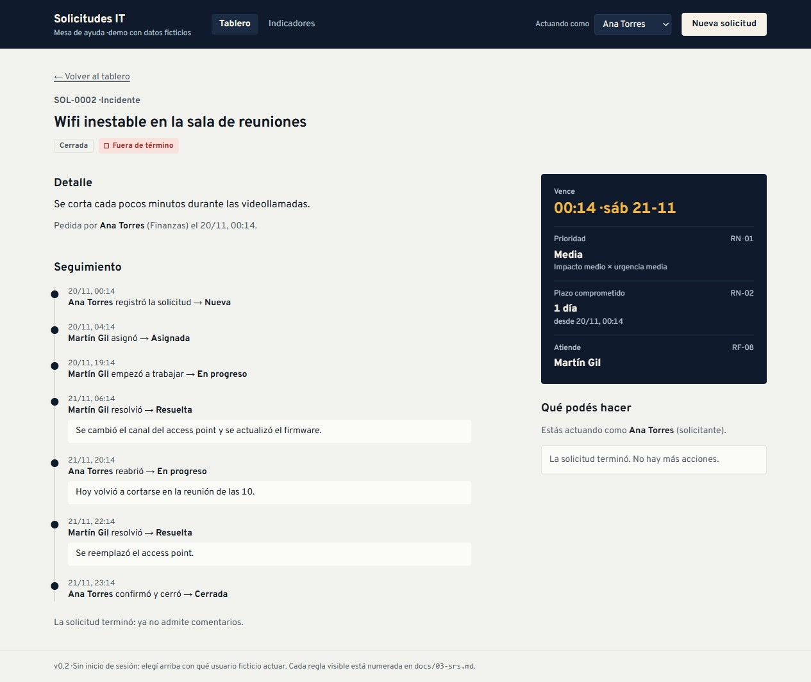
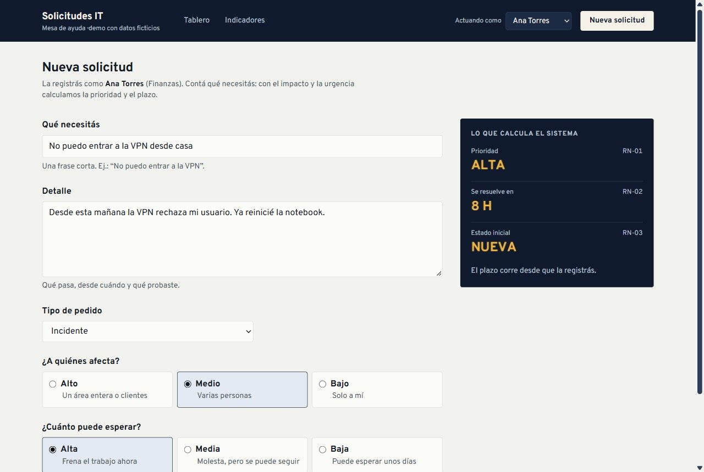

# solicitudes-it

Portal de solicitudes internas a IT: un único canal donde cada pedido recibe una **prioridad calculada**, un **vencimiento de SLA** y un **ciclo de vida con permisos por rol** (solicitante, agente de mesa de ayuda y aprobador), con seguimiento e indicadores de gestión.

Es un proyecto de portfolio que muestra la cadena completa **relevamiento → requisitos → diseño → código → tests**. Cada regla visible en pantalla tiene un ID en la documentación y un test que la verifica.


## Problema

En la organización del caso (ficticia), los pedidos a IT llegaban por mail, chat y pasillo. No había un criterio de prioridad ni un plazo comprometido, y no quedaba registro de lo que pasaba con cada uno. El relevamiento completo está en [docs/01-relevamiento.md](docs/01-relevamiento.md).

## Qué hace (v0.2)

| Funcionalidad | Requisito | Regla |
|---|---|---|
| Registrar una solicitud en lenguaje simple (impacto: "¿a quiénes afecta?", urgencia: "¿cuánto puede esperar?") | RF-01 | — |
| Calcular la prioridad con una matriz impacto × urgencia | RF-02 | RN-01 |
| Calcular el vencimiento según la prioridad (4, 8, 24 o 72 h) | RF-03 | RN-02 |
| Dejar pendientes de aprobación las categorías sensibles, sin correr el SLA | RF-04 | RN-03 |
| Tablero ordenado por lo que vence primero, con vistas "Mis pedidos" / "Asignadas a mí" y filtro por estado | RF-05 | — |
| Aprobar o rechazar (con motivo) | RF-07 | RN-06 |
| Asignar, empezar, resolver (con nota), confirmar y cerrar, reabrir, cancelar | RF-08, RF-09 | RN-04, RN-06 |
| Editar el pedido antes de que lo tomen, recalculando prioridad y plazo | RF-11 | RN-01, RN-02 |
| Seguimiento: cambios de estado y comentarios en una sola línea de tiempo | RF-06, RF-12 | — |
| Semáforo de SLA, incluido si se resolvió a tiempo | RF-10 | RN-05 |
| Indicadores: cumplimiento de SLA, vencidas, carga por agente, creadas vs. resueltas | RF-13 | RN-05 |

Cada acción se ofrece solo a quien puede ejecutarla y se valida otra vez en el servidor:




El formulario muestra en vivo lo que va a calcular el sistema y cita la regla que lo produce:



**Pendiente:** inicio de sesión real (RNF-03). Mientras tanto, un selector **"Actuando como"** simula al usuario. Los permisos se validan igual en el servidor, así que un login real solo reemplaza `src/lib/actor.ts`. El estado de cada requisito está en la [matriz de trazabilidad](docs/06-trazabilidad.md).

## Cómo probarlo

1. Como **Ana Torres** (solicitante), registrá un pedido de tipo *Acceso a sistemas*: queda pendiente de aprobación, sin plazo corriendo.
2. Cambiá a **Diego Sosa** (aprobador) y aprobalo: empieza a correr el SLA.
3. Cambiá a **Carla Ríos** (agente), asignátelo, empezá a trabajar, dejá un comentario y resolvelo.
4. Volvé a **Ana Torres** y confirmalo o reabrilo.
5. Mirá cómo cambian los **Indicadores**.

## Documentación

| Documento | Contenido |
|---|---|
| [Relevamiento](docs/01-relevamiento.md) | Partes interesadas, problemas, objetivos y alcance |
| [Procesos](docs/02-procesos.md) | BPMN AS-IS / TO-BE y diagrama de estados (Mermaid) |
| [SRS](docs/03-srs.md) | Reglas de negocio y requisitos funcionales y no funcionales |
| [Historias de usuario](docs/04-historias.md) | Criterios de aceptación en Gherkin |
| [Modelo de datos](docs/05-modelo-datos.md) | DER y diccionario de datos |
| [Trazabilidad](docs/06-trazabilidad.md) | Objetivo → requisito → historia → test → código |
| [Decisiones](docs/decisiones/) | ADRs de arquitectura |

## Stack

Next.js 16 (App Router, Server Actions) · TypeScript · Tailwind CSS 4 · PostgreSQL · Drizzle ORM · Zod · Vitest · GitHub Actions

```
src/
  domain/      reglas de negocio puras (RN-xx) y permisos por rol, sin framework ni base de datos
  db/          esquema Drizzle, conexión y datos semilla
  services/    casos de uso (alta, acciones, edición, comentarios, indicadores)
  app/         pantallas y Server Actions
tests/         49 tests nombrados por ID de requisito
docs/          relevamiento, SRS, historias, modelo, trazabilidad, ADRs
drizzle/       migraciones SQL generadas
```

## Cómo correrlo

Necesitás Node.js 24 o superior. No hace falta instalar PostgreSQL: en desarrollo se usa PGlite, un PostgreSQL embebido ([ADR-002](docs/decisiones/ADR-002-pglite-desarrollo.md)).

```bash
npm install
npm run db:demo   # opcional: carga una semana de solicitudes de ejemplo (--reset para recargar)
npm run dev       # http://localhost:3000
```

Para usar un PostgreSQL real, definí `DATABASE_URL`. Las migraciones se aplican al iniciar.

```bash
npm test          # tests de dominio e integración contra PostgreSQL en memoria
npm run lint
npm run typecheck
```

## Datos

Todas las personas, áreas y solicitudes son ficticias.
