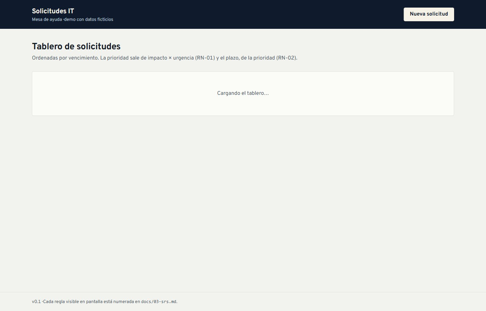

# solicitudes-it

Portal de solicitudes internas a IT: un único canal donde cada pedido recibe una **prioridad calculada**, un **vencimiento de SLA** y un **estado** que sigue un ciclo de vida definido.

Es un proyecto de portfolio que muestra la cadena completa **relevamiento → requisitos → diseño → código → tests**. Cada regla visible en pantalla tiene un ID en la documentación y un test que la verifica.



## Problema

En la organización del caso (ficticia), los pedidos a IT llegaban por mail, chat y pasillo. No había un criterio de prioridad ni un plazo comprometido, y no quedaba registro de lo que pasaba con cada uno. El relevamiento completo está en [docs/01-relevamiento.md](docs/01-relevamiento.md).

## Qué hace (v0.1)

| Funcionalidad | Requisito | Regla |
|---|---|---|
| Registrar una solicitud en lenguaje simple (impacto: "¿a quiénes afecta?", urgencia: "¿cuánto puede esperar?") | RF-01 | — |
| Calcular la prioridad con una matriz impacto × urgencia | RF-02 | RN-01 |
| Calcular el vencimiento según la prioridad (4, 8, 24 o 72 h) | RF-03 | RN-02 |
| Dejar pendientes de aprobación las categorías sensibles, sin correr el SLA | RF-04 | RN-03 |
| Tablero ordenado por vencimiento, con filtro por estado | RF-05 | — |
| Semáforo de SLA: en término / en riesgo / vencida | RF-10 | RN-05 |
| Historial de estados | RF-06 | — |

El formulario muestra en vivo lo que va a calcular el sistema y cita la regla que lo produce:


**Pendiente (documentado, no implementado):** aprobar y rechazar (RF-07), asignar (RF-08), cambios de estado desde la interfaz (RF-09) y autenticación por roles (RNF-03). El estado de cada requisito está en la [matriz de trazabilidad](docs/06-trazabilidad.md).

## Documentación

| Documento | Contenido |
|---|---|
| [Relevamiento](docs/01-relevamiento.md) | Partes interesadas, problemas, objetivos y alcance |
| [Procesos](docs/02-procesos.md) | BPMN AS-IS / TO-BE y diagrama de estados (Mermaid) |
| [SRS](docs/03-srs.md) | Reglas de negocio y requisitos funcionales y no funcionales |
| [Historias de usuario](docs/04-historias.md) | Criterios de aceptación en Gherkin |
| [Modelo de datos](docs/05-modelo-datos.md) | DER y diccionario de datos |
| [Trazabilidad](docs/06-trazabilidad.md) | Objetivo → requisito → historia → test → código |
| [Decisiones](docs/decisiones/) | ADRs de arquitectura |

## Stack

Next.js 16 (App Router, Server Actions) · TypeScript · Tailwind CSS 4 · PostgreSQL · Drizzle ORM · Zod · Vitest · GitHub Actions

```
src/
  domain/      reglas de negocio puras (RN-xx), sin framework ni base de datos
  db/          esquema Drizzle, conexión y datos semilla
  services/    casos de uso (alta, listado, historial)
  app/         pantallas y Server Actions
tests/         tests nombrados por ID de requisito
docs/          relevamiento, SRS, historias, modelo, trazabilidad, ADRs
drizzle/       migraciones SQL generadas
```

## Cómo correrlo

Necesitás Node.js 24 o superior. No hace falta instalar PostgreSQL: en desarrollo se usa PGlite, un PostgreSQL embebido ([ADR-002](docs/decisiones/ADR-002-pglite-desarrollo.md)).

```bash
npm install
npm run db:demo   # opcional: carga solicitudes de ejemplo
npm run dev       # http://localhost:3000
```

Para usar un PostgreSQL real, definí `DATABASE_URL`. Las migraciones se aplican al iniciar.

```bash
npm test          # tests de dominio e integración contra PostgreSQL en memoria
npm run lint
npm run typecheck
```

## Datos

Todas las personas, áreas y solicitudes son ficticias.
