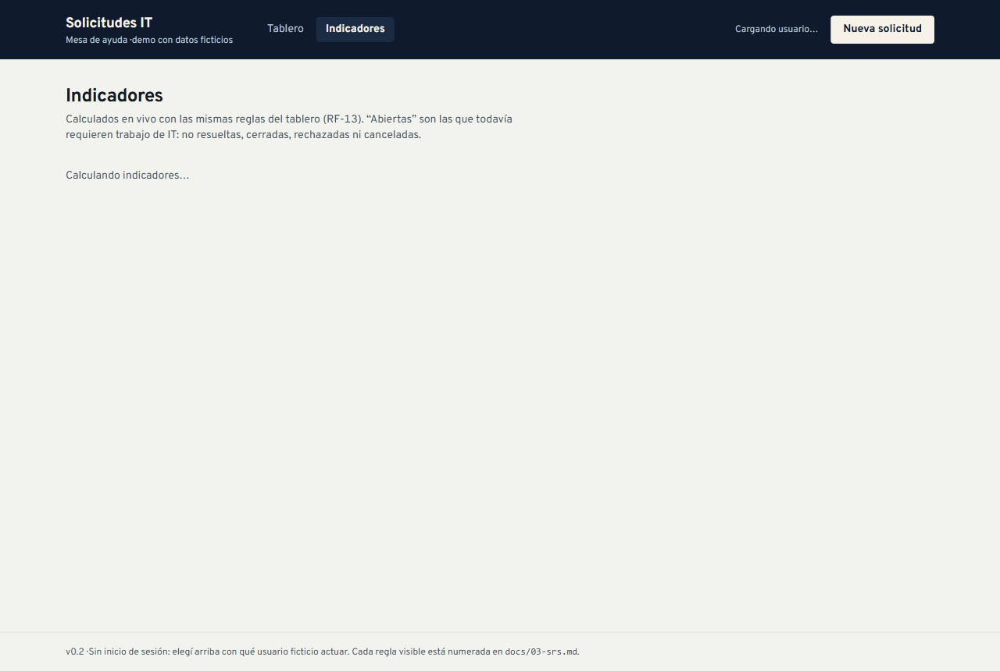

# Solicitudes a IT

Un solo lugar para los pedidos internos al área de sistemas. Reemplaza los pedidos sueltos por mail, chat o pasillo, donde no queda claro qué es urgente ni en qué estado está cada cosa.


## Qué se puede hacer

- **Cargar un pedido en lenguaje simple.** El sistema calcula la prioridad y el plazo según a quiénes afecta y cuánto puede esperar.
- **Aprobar lo sensible.** Algunos pedidos, como los accesos, necesitan aprobación antes de que empiece a correr el plazo.
- **Seguir cada caso.** Se puede asignar, resolver, cerrar o reabrir, con comentarios e historial en un mismo lugar.
- **Ver qué está en riesgo.** El tablero ordena por vencimiento y los indicadores muestran el cumplimiento de plazos y la carga de trabajo.

Cada persona ve las acciones que le corresponden según su función: quien pide, quien atiende o quien aprueba.





## Estado

Es un proyecto de portfolio y todas las personas y los pedidos son ficticios. Todavía no tiene inicio de sesión real: un selector **"Actuando como"** permite probar la aplicación con distintos usuarios.

## Cómo probarlo

Necesitás Node.js 24 o superior. No hace falta instalar una base de datos.

```bash
npm install
npm run db:demo   # opcional: carga pedidos de ejemplo (--reset para volver a cargarlos)
npm run dev       # http://localhost:3000
npm test
```

Para ver el recorrido completo:

1. Como **Ana Torres**, cargá un pedido de *Acceso a sistemas*.
2. Cambiá a **Diego Sosa** y aprobalo.
3. Cambiá a **Carla Ríos**, tomá el pedido, empezá a trabajar y resolvelo.
4. Volvé a **Ana Torres** para confirmarlo o reabrirlo.

## Cómo está hecho

Next.js, TypeScript, Tailwind CSS y PostgreSQL. En desarrollo usa una base incluida; para conectar otra, definí `DATABASE_URL`.

Antes de programar relevé el problema y definí los requerimientos. Todo está en [`docs/`](docs/): [relevamiento](docs/01-relevamiento.md), [procesos](docs/02-procesos.md), [requerimientos](docs/03-srs.md), [historias de usuario](docs/04-historias.md), [modelo de datos](docs/05-modelo-datos.md), [relación entre requerimientos y pruebas](docs/06-trazabilidad.md) y [decisiones técnicas](docs/decisiones/).
