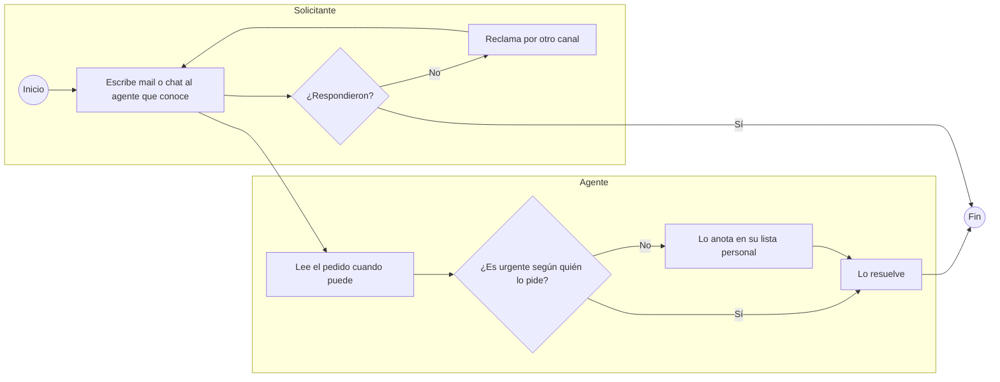
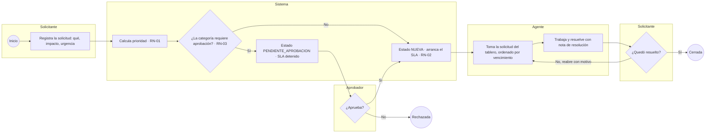
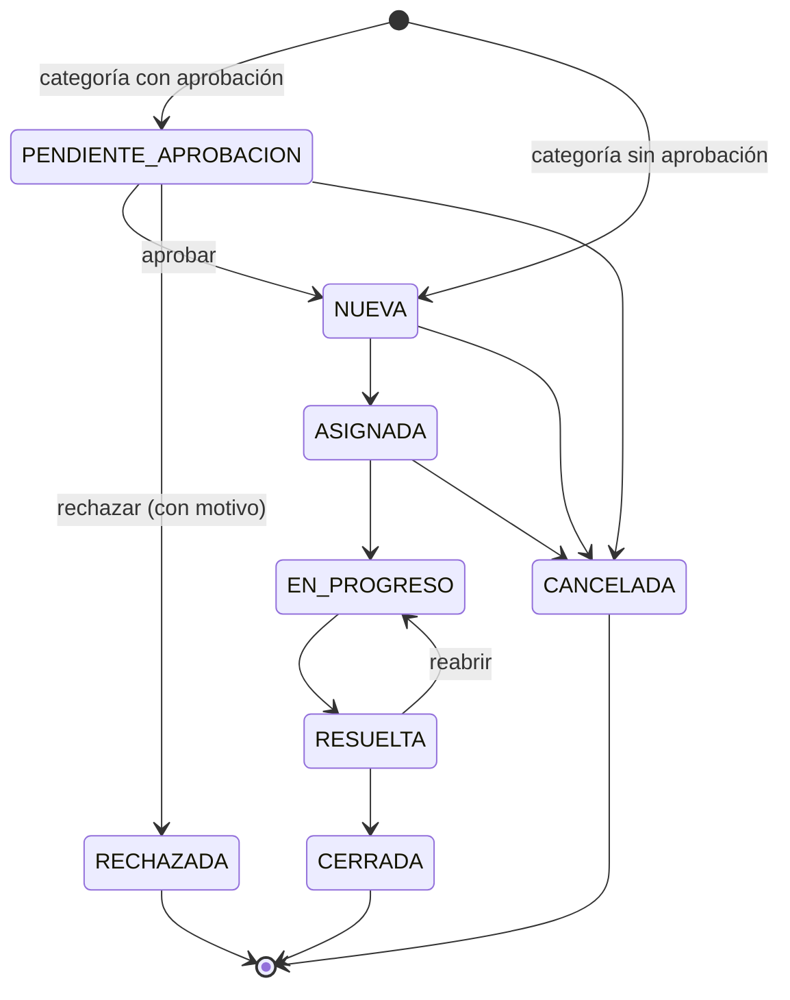

# 02 · Procesos (AS-IS / TO-BE)

Los diagramas siguen la notación BPMN de forma simplificada: carriles por rol, eventos de inicio y fin, tareas y compuertas. Están escritos en Mermaid para que se versionen junto con el código.

## AS-IS: cómo se pide hoy

Puntos de dolor: P-01 (canales múltiples), P-02 (prioridad subjetiva en la compuerta F), P-03 (sin plazo), P-05 (sin registro).

## TO-BE: con solicitudes-it

Desde v0.2 están implementados todos los carriles: registro, aprobación (RF-07), asignación y trabajo del agente (RF-08, RF-09), con los permisos de RN-06.

## Ciclo de vida de una solicitud (RN-04)

La tabla `TRANSICIONES` de [`src/domain/solicitud.ts`](../src/domain/solicitud.ts) es la fuente única de este diagrama y está cubierta por tests.

Siguiente: [03 · SRS](03-srs.md).
