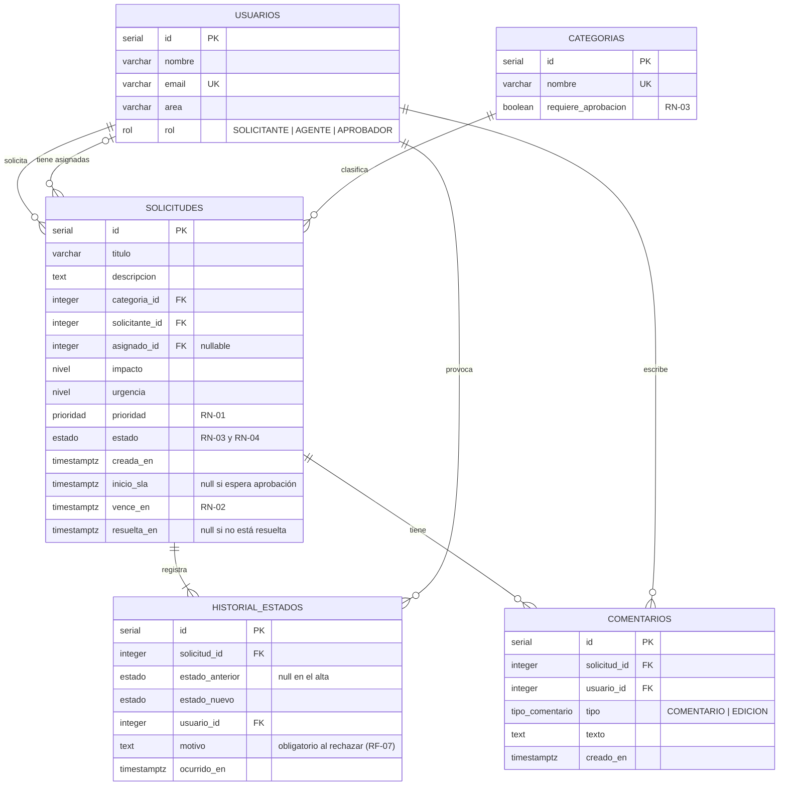

# 05 · Modelo de datos

Fuente de verdad: [`src/db/schema.ts`](../src/db/schema.ts). La migración SQL generada está en [`drizzle/`](../drizzle/).

## Diagrama entidad-relación

## Diccionario de datos

| Tabla.columna | Tipo | Nulo | Regla / descripción |
|---|---|---|---|
| `solicitudes.prioridad` | enum `prioridad` | No | Se calcula; nunca la elige el usuario (RN-01). |
| `solicitudes.estado` | enum `estado` | No | Inicial según la categoría (RN-03); cambia solo por transiciones válidas (RN-04). |
| `solicitudes.inicio_sla` | timestamptz | Sí | Momento desde el que corre el plazo. Es `null` mientras espera aprobación. |
| `solicitudes.vence_en` | timestamptz | Sí | `inicio_sla + horas(prioridad)` (RN-02). Indexado para ordenar el tablero. |
| `solicitudes.resuelta_en` | timestamptz | Sí | Momento de la última resolución; se limpia al reabrir. Base del cumplimiento de SLA (RN-05, RF-13). |
| `historial_estados.estado_anterior` | enum `estado` | Sí | `null` solo en el evento de alta. |
| `comentarios.tipo` | enum `tipo_comentario` | No | `EDICION` lo genera el sistema al editar (RF-11); `COMENTARIO` lo escribe una persona (RF-12). |
| `categorias.requiere_aprobacion` | boolean | No | Define si la solicitud pasa por aprobación (RN-03). |

## Decisiones de modelado

- **Enums de PostgreSQL** para nivel, prioridad, estado y rol. Así la base rechaza valores fuera del dominio aunque falle la validación de la aplicación.
- **Fechas siempre con zona horaria** (RNF-05). La conversión a hora de Argentina se hace solo al mostrar.
- **Prioridad y vencimiento persistidos**, no calculados en cada lectura: si mañana cambia la matriz de SLA, las solicitudes existentes conservan el compromiso con el que se crearon.
- **Historial en una tabla aparte**, de solo inserción: la auditoría (OBJ-05) no depende de la fila actual.

Siguiente: [06 · Matriz de trazabilidad](06-trazabilidad.md).
